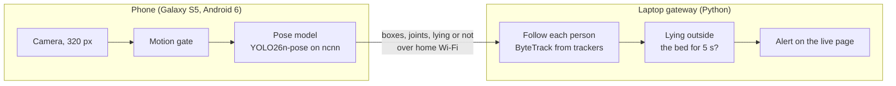

# Fall watch

An old phone on the bedroom wall watches for falls. A 2014 Galaxy S5 runs a tiny pose model on its own
camera and sends only numbers to a laptop: where each person is, their 17 body joints, and whether they are
lying. The laptop raises an alert when someone lies outside the bed for 5 seconds.

No picture leaves the phone unless you switch the preview on, and the phone never talks to the internet.

Built with Roboflow: the dataset, SAM 3 auto labelling and dataset versions on the Roboflow platform, and
Roboflow's open-source [`trackers`](https://github.com/roboflow/trackers) and
[`supervision`](https://github.com/roboflow/supervision) on the laptop.

<!-- Demo video: add the link here. -->

## How it works



- **Phone.** The app runs the model with ncnn on the phone's 32-bit processor. For each person it finds,
  it outputs a box, 17 COCO body joints and a posture: `lying` or `not lying`. It sends these in small
  batches over plain HTTP on the home network.
- **Motion gate.** When nothing moves, the phone runs the model about once a second instead of 3 to 5
  times. This keeps the phone cool enough to run all day: 55 °C after 3 hours, against 64 to 73 °C within an
  hour without it.
- **Gateway.** The laptop follows each person from frame to frame with ByteTrack and keeps a timer for
  each one. Lying in a bed zone is fine. Lying anywhere else for 5 seconds raises an alert. The alert ends
  when that person is seen up again, or when someone presses "clear" on the live page.
- **Live page.** It shows stick figures, the bed zones and the alerts at `http://<laptop>:8000`. With the
  preview on, it also shows the camera picture, and can record clips for training.

## Results

The model on the phone is **fall-v3**. It's YOLO26n-pose at 320 px, trained on two public fall datasets
plus 1,053 pictures from the room it watches. The scores come from `fall_watch.eval_falls`, which runs the
phone's own model files and the gateway's own alert code on video clips.

| Test clips | Stock pose model + body-angle rule | fall-v2 (public data only) | fall-v3 (on the phone) |
| --- | --- | --- | --- |
| Our room, 8 acted falls, alert after 5 s | not run | 0 of 8 | **8 of 8** |
| Our room, 3 normal clips (one is a fall onto the bed) | not run | 0 false alarms | **0 false alarms** |
| GMDCSA-24, unseen room 3: 17 falls, 16 normal clips | 12 caught, 4 false alarms | 16 caught, 2 false alarms | **16 caught, 4 false alarms** |
| CAUCAFall, unseen people 9 and 10: 10 falls, 10 normal | 6 caught, 1 false alarm | 10 caught, 0 false alarms | **10 caught, 0 false alarms** |

- The public clips are only 4 to 10 seconds long, so they're scored with the alert after 1 second. The
  false alarms there are push-ups and sitting on the floor, which last less than the real 5 seconds.
- The room clips are from the same room and person as the room training pictures, but they're separate
  recordings. They show the model works in this room. They don't show it works in any room.
- On the phone: about 0.2 to 0.33 s per frame with 4 threads. After 3 h 15 min with the motion gate on, the
  processor was at 55 °C and the battery went from 25% to 23% while plugged into a laptop's USB.
- The full numbers are in [`measurements/`](measurements/), and the limits are in [HANDOFF.md](HANDOFF.md).

## Run it

### 1. The laptop gateway

You need [uv](https://docs.astral.sh/uv/) and Python 3.12.

```bash
uv sync
uv run fall-gateway --host 0.0.0.0 --bed 0.47,0.04,1.0,0.81
```

Open `http://localhost:8000`. `--bed x1,y1,x2,y2` is the bed zone, in fractions (0 to 1) of the upright
camera picture. Repeat it for more beds, or leave it out for none.

### 2. The phone

Any Android phone from 6.0 up that can run 32-bit ARM apps should work. Only the Galaxy S5 has been
tested. On the phone, turn on USB debugging. Then, with the phone on USB:

```bash
# app-release.apk from the GitHub release, or your own build
deploy/setup_phone.sh http://<laptop-ip>:8000 path/to/app-release.apk
```

This installs the app, gives it the camera, points it at the gateway and starts it, with the preview off.
The app starts again by itself when the phone reboots.

To change settings later, send a broadcast. Any setting you leave out keeps its value:

```bash
adb shell am broadcast -n com.fallwatch.app/.ConfigReceiver \
  --ei rotation 180 --ez preview true --ei threads 4 --ez motion_gate true --es model models/fall-v3
```

- `rotation` turns the picture upright: 0, 90, 180 or 270.
- `preview` sends camera pictures to the live page. Use it only to set up the bed zone or record clips.
- `model` can be `models/fall-v3` or `models/pose-coco`. `pose-coco` is the stock model, which decides
  "lying" from the body angle.

For a phone that does only this job, use `deploy/provision.sh` instead. It makes the app the device owner
and hides the other apps. Its header explains how to undo that.

### 3. The bed zone

Switch the preview on and look at the live page. Note where the bed is, as fractions of the picture's width
and height from the top left. Restart the gateway with those numbers in `--bed`, and switch the preview off
again.

### Wi-Fi

If the live page says "waiting on phone" in red, the phone is sending late, and so are the alerts. Many
routers have a 2.4 GHz and a 5 GHz radio under one name, and the phone may pick the weaker one. The header of
`deploy/provision.sh` shows how to pin the phone to the stronger radio.

## Build the phone app

You need:

- the Android SDK (build-tools 34);
- NDK r27c;
- JDK 17;
- [ncnn](https://github.com/Tencent/ncnn) built for `armeabi-v7a`. We built commit `c15904b` with the NDK's
  `android.toolchain.cmake`, plus `-DANDROID_ABI=armeabi-v7a -DANDROID_ARM_NEON=ON -DANDROID_PLATFORM=android-23
  -DNCNN_VULKAN=OFF -DCMAKE_BUILD_TYPE=Release`, then `make install`.

Then:

```bash
cp android/local.properties.example android/local.properties   # fill in your paths
mkdir -p android/app/src/main/assets/models
unzip models-ncnn.zip -d android/app/src/main/assets/models     # from the release, or from training
cd android && ./gradlew assembleDebug                            # or assembleRelease with a key set up
```

The model files aren't in git. `models-ncnn.zip` on the GitHub release holds fall-v3 and the stock
`pose-coco`. A model you train yourself lands in `models/<name>/` with the same three files.

## Train your own model

Training needs a CUDA GPU and the `train` dependency group. Labelling needs the `teacher` group.

1. **Data.** Download [CAUCAFall](https://data.mendeley.com/datasets/7w7fccy7ky/4) and
   [GMDCSA-24](https://zenodo.org/records/13354453) into `data/`. To add your own room, switch the preview on
   and record clips from the live page: `room-*` clips for training, `test-fall-*` and other `test-*` clips
   for testing.
2. **Labels.** `fall_watch.fall_data` takes the posture from each dataset's own labels and the box and joints
   from RF-DETR Keypoint, used as a teacher. It writes a COCO keypoint dataset for each source.
   ```bash
   uv run --group teacher python -m fall_watch.fall_data --caucafall "data/caucafall/raw/Dataset CAUCAFall/CAUCAFall" --out data/fall-caucafall
   ```
3. **Roboflow.** Put your private API key in `.env` as `ROBOFLOW_API_KEY=...`. Then upload each dataset and
   make a version:
   ```bash
   uv run python -m fall_watch.roboflow_io --upload data/fall-caucafall --batch caucafall
   uv run python -m fall_watch.roboflow_io --export data/rf-fall
   ```
   Some room pictures get no person from the teacher, often someone lying on the floor seen from above.
   `--autolabel-room` sends those to Roboflow's SAM 3 Auto Label, and `--accept` brings the result back.
   This costs Roboflow credits.
4. **Train and export** for the phone. The files land in `models/<name>/`:
   ```bash
   uv run --group train python -m fall_watch.train --data data/rf-fall/data.yaml --name my-model
   ```
5. **Score** the falls caught and the false alarms:
   ```bash
   uv run --group train python -m fall_watch.eval_falls --model mine=models/my-model \
     --caucafall "data/caucafall/raw/Dataset CAUCAFall/CAUCAFall" --out measurements/falls-mine.json
   ```

Each command's `--help` has the rest. Tests: `uv run pytest`. The two training tests are skipped unless you
use `--group train`.

## What's where

| Folder | What it holds |
| --- | --- |
| `android/` | The phone app: camera, motion gate, ncnn detector (`detector.cpp`), sending to the gateway |
| `src/fall_watch/gateway/` | The laptop gateway: HTTP server, tracking and alerts (`fall_watch.py`), live page |
| `src/fall_watch/` | Data conversion, Roboflow upload and export, training, fall scoring |
| `deploy/` | Phone setup over adb, the heat test, the RAM measurement |
| `measurements/` | Fall scores, heat, RAM and speed on the phone |

## Licences

The code is under the [AGPL-3.0](LICENSE), because the model is built on Ultralytics YOLO26, which is
AGPL-3.0. Other parts:

| Part | Licence |
| --- | --- |
| Ultralytics YOLO26 and the trained fall-v3 weights | AGPL-3.0 |
| CAUCAFall dataset | CC BY 4.0 |
| GMDCSA-24 dataset | MIT (LICENSE file in the download; Zenodo lists CC BY 4.0) |
| COCO keypoint annotations, behind the pretrained weights | CC BY 4.0 |
| RF-DETR and its keypoint checkpoint (teacher) | Apache-2.0 |
| SAM 3 (used through Roboflow Auto Label) | SAM License (Meta) |
| Roboflow `trackers` | Apache-2.0 |
| Roboflow `supervision` | MIT |
| ncnn | BSD-3-Clause |
